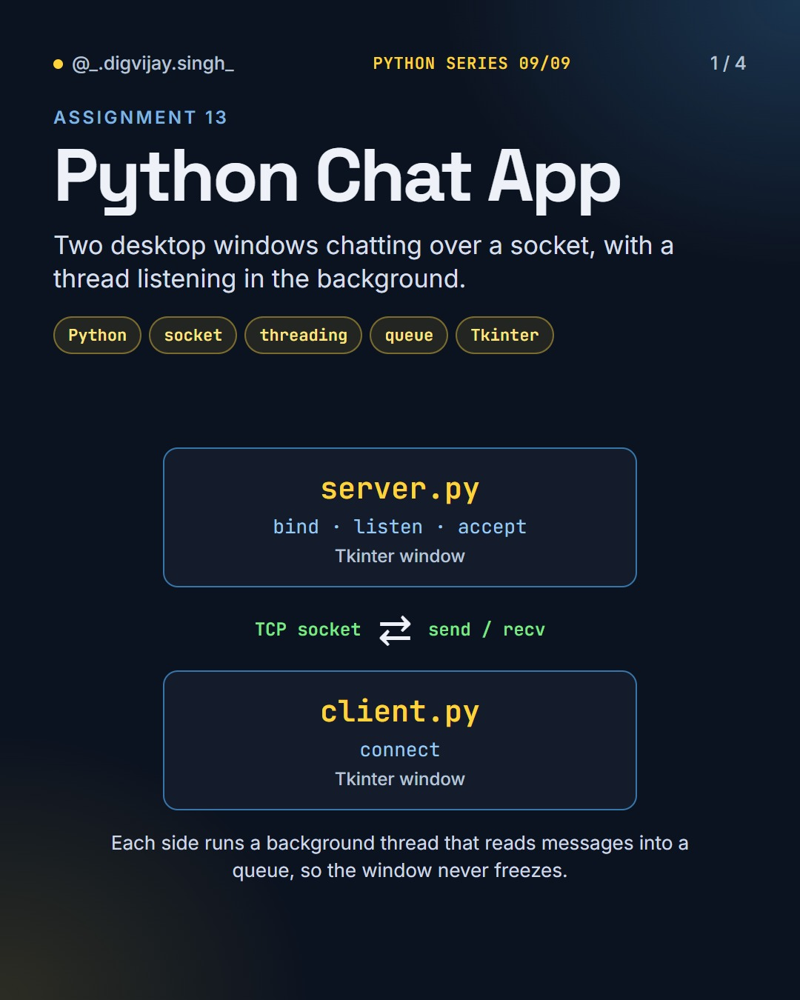
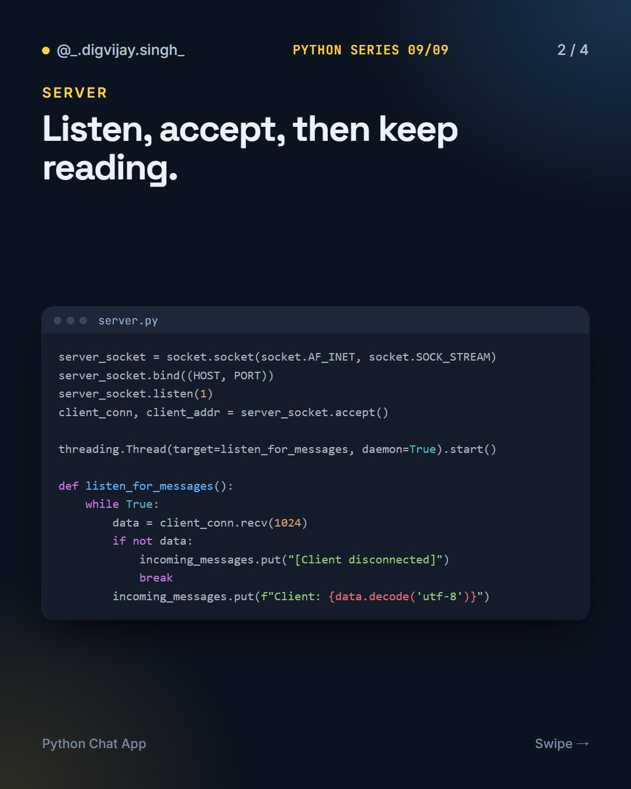
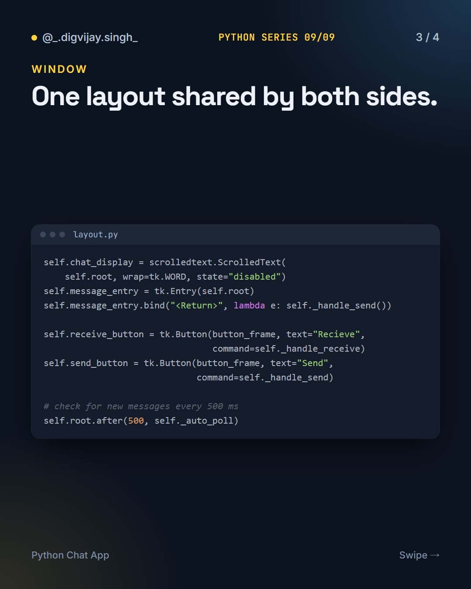
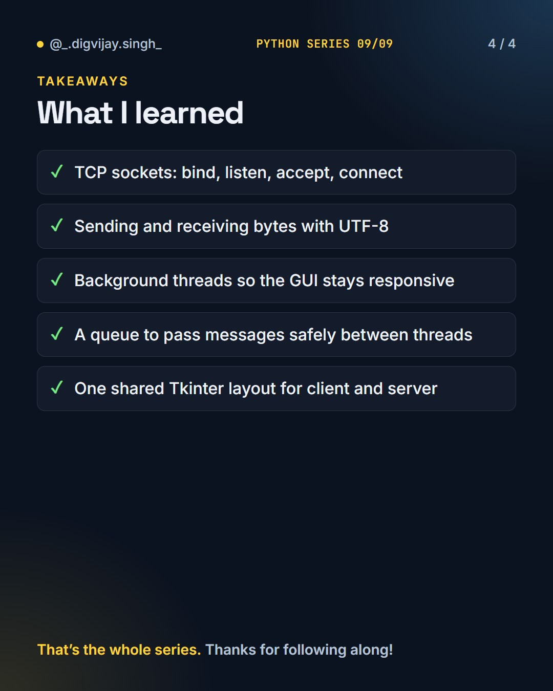

# Python Chat App

<p align="center"></p>

A two-window desktop chat app in Python: TCP sockets, a background listener thread and a shared Tkinter interface.

Part 9 of 9 in my **Python Series**.

## How to run

Open two terminals in this folder. Start the server first, then the client:

```bash
python server.py
```

```bash
python client.py
```

Or run `python main.py` and pick a side.

## What I learned

- TCP sockets: bind, listen, accept, connect
- Sending and receiving bytes as UTF-8
- Background threads so the GUI stays responsive
- A queue to pass messages safely between threads
- One shared Tkinter layout for client and server

## Slides

<p>



</p>

## The Python Series

1. [Python Basics](https://github.com/digvijay165/python-basics)
2. [Tkinter Calculator](https://github.com/digvijay165/tkinter-calculator)
3. [Python + PostgreSQL](https://github.com/digvijay165/python-postgresql)
4. [Flask Registration Form](https://github.com/digvijay165/flask-registration-form)
5. [Django REST Blog API](https://github.com/digvijay165/django-rest-blog-api)
6. [Python Web Scraper](https://github.com/digvijay165/python-web-scraper)
7. [OpenCV Practicals](https://github.com/digvijay165/opencv-practicals)
8. [Selenium Automation](https://github.com/digvijay165/selenium-automation)
9. **Python Chat App**
